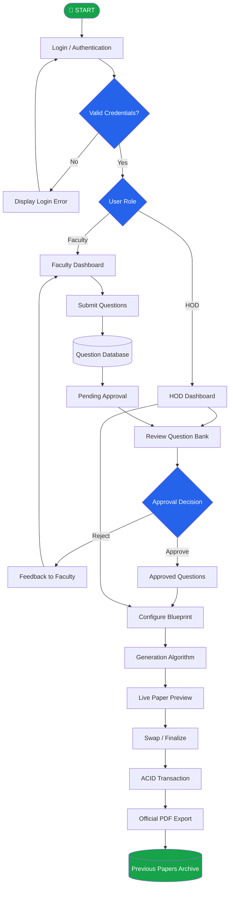
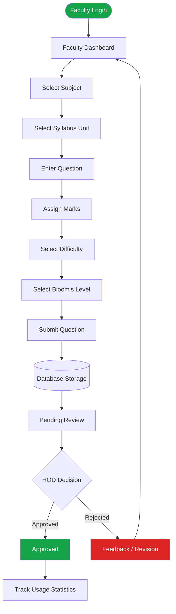
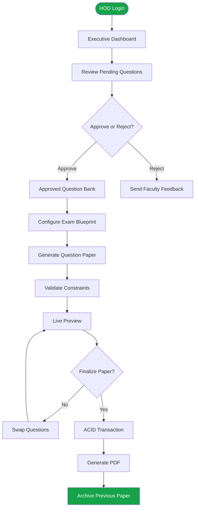
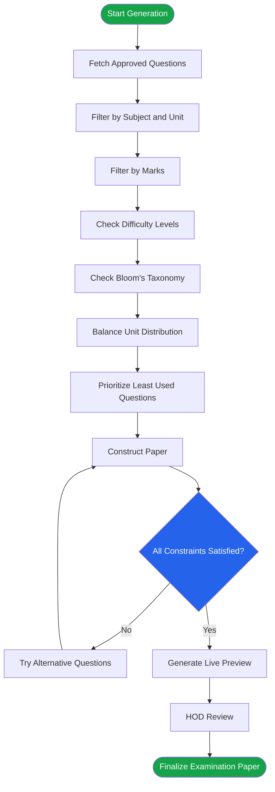
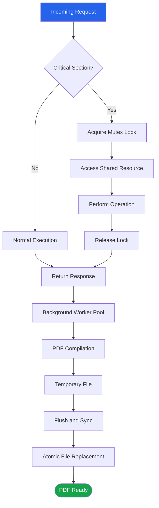
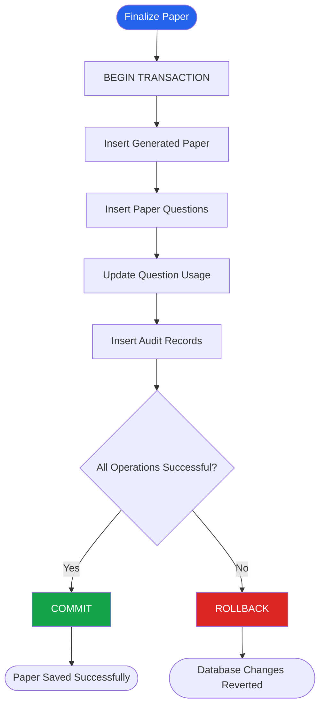
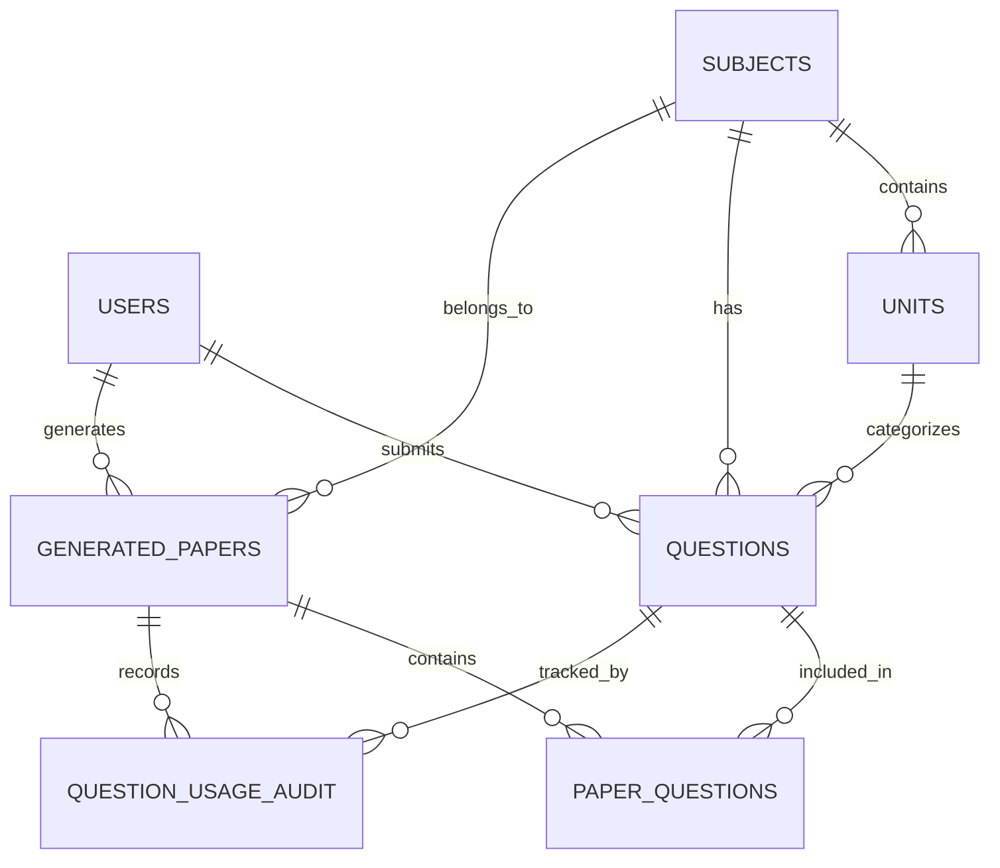

# 🎓 Automated Question Paper Generator
### Intelligent Examination Management System | OS & DBMS Powered

<p align="center">
  
  
  
  
</p>

<p align="center">
  <b>Automating Examination Paper Setting Through Intelligent Algorithms, Operating Systems and Database Management Systems.</b>
</p>

---

## 📌 About The Project

The **Automated Question Paper Generator** is an intelligent examination management system developed to eliminate the traditional manual process of setting question papers.

It uses an algorithmic constraint-based approach to generate balanced examination papers while considering:

- 📚 Syllabus and unit-wise distribution
- 🧠 Bloom's Taxonomy (L1–L6)
- ⚖️ Difficulty balancing (Easy, Medium, Hard)
- 🔄 Question fatigue avoidance
- 🔐 Database consistency and concurrency control

The application provides two dedicated portals — **Faculty and HOD** — enabling a complete workflow from question submission and approval to automated paper generation and official PDF export.

<details>
<summary><b>📋 Project Highlights</b></summary>

| Component | Implementation |
|---|---|
| Backend | Python + Flask |
| Database | SQLite |
| Frontend | HTML, CSS, JavaScript, Tailwind CSS |
| OS Concepts | Mutex, Synchronization, Multithreading, Atomic Operations |
| DBMS Concepts | Normalization, ACID, Indexing, WAL, Views |
| PDF Generation | ReportLab |
| Testing | Automated Test Suite |

</details>

---

## ✨ Project Features

| Feature | Description | Status |
|---|---|:---:|
| 🔐 Authentication | Secure login and role-based access | ✅ |
| 👨‍🏫 Faculty Portal | Question submission and tracking | ✅ |
| 🧑‍💼 HOD Portal | Question approval and management | ✅ |
| 📝 Question Bank | Centralized question repository | ✅ |
| 🧠 Bloom's Taxonomy | L1–L6 cognitive classification | ✅ |
| ⚙️ Smart Generation | Constraint-based paper generation | ✅ |
| 📊 Live Analytics | Unit and difficulty distribution | ✅ |
| 🔄 Question Swapping | Equal-mark alternative selection | ✅ |
| 📄 PDF Export | Official examination paper generation | ✅ |
| 📚 Paper Archive | Previous papers and downloads | ✅ |
| 🔒 OS Synchronization | Mutex and concurrency control | ✅ |
| 💾 ACID Transactions | Reliable paper finalization | ✅ |
| 🧪 Automated Testing | End-to-end workflow validation | ✅ |

---

# 🏗️ SYSTEM ARCHITECTURE

## 1. Complete Application Workflow



## 2. Faculty Portal Workflow



## 3. HOD Portal Workflow



---

# 🧠 INTELLIGENT QUESTION PAPER GENERATION

The generation engine selects questions according to multiple academic constraints to produce a balanced examination paper.

## Generation Algorithm Flow



### Examination Blueprint Example

| Section | Questions | Marks Each | Total |
|---|---:|---:|---:|
| Part A | 5 | 2 | 10 |
| Part B | 4 | 5 | 20 |
| Part C | 2 | 10 | 20 |
| **TOTAL** | **11** | | **50 Marks** |

### Bloom's Taxonomy Integration

| Level | Cognitive Skill | Description |
|:---:|---|---|
| L1 | Remember | Recall facts and definitions |
| L2 | Understand | Explain concepts |
| L3 | Apply | Solve problems using knowledge |
| L4 | Analyze | Compare and examine concepts |
| L5 | Evaluate | Justify and assess decisions |
| L6 | Create | Design and develop solutions |

### Question Fatigue Avoidance

The algorithm prioritizes questions using:

- Lowest `usage_count`
- Oldest `last_used_at`
- Subject and unit compatibility
- Marks and difficulty requirements

This reduces repeated questions and improves examination variety.

---

# ⚙️ OPERATING SYSTEMS IMPLEMENTATION

The project implements real-world OS concepts to manage concurrent users, shared resources, and file operations.

| OS Concept | Real-World Application | Code Implementation |
|---|---|---|
| Process Synchronization | Prevents conflicting simultaneous operations | `threading.Lock()` |
| Mutex Locks | Protects shared question bank and audit logs | `generation_mutex`, `audit_log_mutex` |
| Multithreading | Background PDF and export operations | `ThreadPoolExecutor(max_workers=4)` |
| Atomic File Operations | Prevents incomplete or corrupted PDF files | `tempfile`, `os.fsync()`, `os.replace()` |
| Memory Management | Reduces repeated loading of static information | `@lru_cache(maxsize=32)` |
| Deadlock Avoidance | Consistent resource acquisition ordering | Lock hierarchy |

## OS Concurrency Flow



---

# 🗄️ DATABASE MANAGEMENT SYSTEMS IMPLEMENTATION

| DBMS Concept | Purpose | Implementation |
|---|---|---|
| Normalization (3NF / BCNF) | Reduces redundancy and anomalies | Relational schema |
| ACID Transactions | Ensures reliable paper finalization | `BEGIN`, `COMMIT`, `ROLLBACK` |
| B-Tree Indexing | Improves question retrieval performance | Composite index |
| Referential Integrity | Maintains valid relationships | Foreign Keys |
| Constraints | Prevents invalid database values | `CHECK` constraints |
| Database Views | Provides question bank analytics | `view_subject_question_stats` |
| Write-Ahead Logging | Supports concurrent database readers during writes | `PRAGMA journal_mode = WAL` |

## ACID Transaction Workflow



### ACID Properties

| Property | Meaning | Application |
|---|---|---|
| Atomicity | All or nothing | Complete paper finalization |
| Consistency | Maintains valid data | Database constraints |
| Isolation | Prevents improper transaction interference | Transaction management and WAL |
| Durability | Committed data persists | Database storage |

---

# 🏛️ DATABASE ARCHITECTURE

## Main Database Tables

| Table | Purpose |
|---|---|
| `users` | Stores Faculty and HOD accounts |
| `subjects` | Stores subject information |
| `units` | Stores syllabus units |
| `questions` | Stores questions and academic attributes |
| `generated_papers` | Stores generated paper details |
| `paper_questions` | Maps questions to generated papers |
| `question_usage_audit` | Tracks question usage history |

## Entity Relationship Diagram



---

# 👥 APPLICATION MODULES

| Functionality | Faculty | HOD |
|---|:---:|:---:|
| Secure Login | ✅ | ✅ |
| Dashboard | ✅ | ✅ |
| Question Submission | ✅ | ❌ |
| Question Approval | ❌ | ✅ |
| Rejection Feedback | View | Provide |
| Question Usage Tracking | ✅ | ✅ |
| Paper Generation | ❌ | ✅ |
| Live Paper Preview | ❌ | ✅ |
| Question Swapping | ❌ | ✅ |
| PDF Export | ❌ | ✅ |
| Previous Papers Archive | ❌ | ✅ |
| Analytics | Personal | Overall |

---

# 💻 TECHNOLOGY STACK

| Layer | Technology |
|---|---|
| Programming Language | Python 3.10+ |
| Backend Framework | Flask |
| Database | SQLite |
| Frontend | HTML, CSS, JavaScript |
| UI Framework | Tailwind CSS |
| PDF Generation | ReportLab |
| Image Processing | Pillow |
| Authentication | Werkzeug |
| Concurrency | Python Threading |
| Testing | Automated Python Test Suite |

---

# 📂 PROJECT STRUCTURE

```text
Automated-Question-Paper-Generator/
│
├── app.py                  # Flask routes and application logic
├── db.py                   # Database schema and operations
├── generator.py            # Paper generation algorithm
├── os_concurrency.py       # OS synchronization and file handling
├── pdf_exporter.py         # PDF generation and export
├── test_system.py          # Automated testing
│
├── templates/              # HTML templates
├── static/                 # CSS, JavaScript and assets
├── generated_pdfs/         # Generated examination papers
│
└── README.md
```

---

# 🚀 INSTALLATION & SETUP

### Prerequisites

- Python 3.10+
- pip package manager

### Step 1: Clone Repository

```bash
git clone https://github.com/saketbsws17-ai/automated-Qp.git
```

### Step 2: Open Project Directory

```bash
cd Automated-Question-Paper-Generator
```

### Step 3: Install Dependencies

```bash
pip install Flask reportlab pillow werkzeug
```

### Step 4: Initialize Database

```bash
python db.py
```

### Step 5: Run Application

```bash
python app.py
```

### Step 6: Open in Browser

```text
http://127.0.0.1:5000
```

---

# 🔑 DEMO CREDENTIALS

| Role | Username | Password | Access |
|---|---|---|---|
| HOD | `hod` | `hod123` | Complete management access |
| Faculty (OS) | `faculty1` | `fac123` | OS question submission |
| Faculty (DBMS) | `faculty2` | `fac123` | DBMS question submission |

> ⚠️ These credentials are for demonstration purposes only. Change them before production deployment.

---

# 🧪 TESTING & VALIDATION

Run the automated test suite:

```bash
python test_system.py
```

### Test Coverage

| Test Case | Validation |
|---|---|
| Authentication | Faculty and HOD login |
| RBAC | Role-based access |
| Question Submission | Faculty workflow |
| Approval Workflow | HOD verification |
| Paper Generation | Algorithmic constraints |
| Question Swapping | Equal-mark alternatives |
| ACID Transactions | Commit and rollback |
| PDF Generation | Official paper export |
| OS Concurrency | Locks and atomic operations |

---

# 🏆 PROJECT COMPLETION

<details>
<summary><b>✅ Completed Project Milestones</b></summary>

- [x] Flask application and role-based authentication
- [x] Faculty question submission portal
- [x] HOD approval and rejection workflow
- [x] Relational database implementation
- [x] Intelligent question paper generation
- [x] Bloom's Taxonomy integration
- [x] Unit and difficulty balancing
- [x] Question fatigue avoidance
- [x] Live paper preview and question swapping
- [x] ACID transaction-based finalization
- [x] OS synchronization and mutex implementation
- [x] Atomic PDF file operations
- [x] Previous papers archive
- [x] Usage history and analytics
- [x] Automated test suite

</details>

---

## 🎯 PROJECT OBJECTIVE

This project demonstrates the practical integration of **Operating Systems and Database Management Systems** into a real-world examination management application.

By combining synchronization, multithreading, atomic file operations, normalization, indexing, ACID transactions, and concurrency control, the system delivers an automated and reliable approach to examination paper management.

---

<p align="center">
  <b>🎓 PROJECT STATUS: COMPLETED</b>
  <br><br>
  <b>Built with Python • Flask • SQLite • OS • DBMS</b>
  <br><br>
  ⭐ If you find this project interesting, consider giving this repository a star!
</p>
